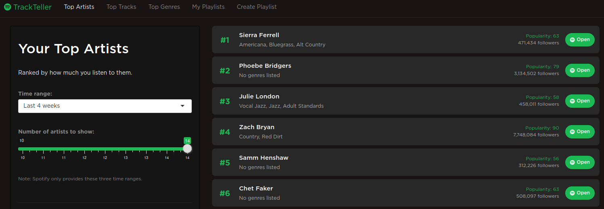

# 🎧 TrackTeller

**TrackTeller** is a Shiny web app that connects to your Spotify account to visualize your listening habits and create playlists from your personal data.

## 🔍 Features

- 🎤 View your top artists ranked by listening frequency (10–50, with popularity and follower count)
- 🎵 Browse your most played tracks with artist, album, duration, and Spotify links
- 🕐 See your recently played tracks
- 🎼 Explore genre distribution with interactive tooltips showing contributing artists
- 📋 Browse your existing Spotify playlists with alphabetical filter and incremental loading
- ✨ Create new playlists from your top tracks, favorite artists, or recently played
- 📸 Download shareable stats cards (top 10 artists or tracks with Spotify images)
- 📱 Mobile-responsive design
- 🔒 Secure OAuth with Spotify (no credentials stored)

## 📸 Screenshot



## 🚀 Live App

👉 [Try it live on Google Cloud Run](https://trackteller.youcanbeapirate.com)

## 🛠️ Project Structure

```text
TrackTeller/
├── app/                     # Everything that goes into the Docker image
│   ├── ui.R                 # Function-based UI (5 tabs + OAuth callback handling)
│   ├── server.R             # Server logic (Spotify API + visualizations + stats cards)
│   ├── run.R                # App entry point
│   ├── scripts/
│   │   ├── spotify_oauth.R  # Custom OAuth 2.0 implementation
│   │   ├── config.R         # Environment-based configuration
│   │   └── global.R         # Shared helpers (ggplot theme, colors)
│   ├── css/
│   │   └── styles.css       # Spotify dark theme + mobile responsiveness
│   └── www/
│       ├── redirect.js      # JavaScript for OAuth redirects
│       └── favicon.png      # App favicon
├── docs/
│   └── index.html           # Static landing page (GitHub Pages)
├── Dockerfile               # Container definition (rocker/shiny:4.3.1 + magick)
├── docker-compose.yml       # Local development orchestration
├── deploy.sh                # Google Cloud Run deployment script
├── DEPLOY.md                # Deployment guide
├── .env.example             # Credential template
└── renv.lock                # Package dependency lock file
```

## 🔄 How It Works

1. **Login**: Click "Log in with Spotify" to authenticate via OAuth.
2. **Top Artists**: See your most-listened artists ranked with popularity scores and Spotify links.
3. **Top Tracks**: Browse your most played tracks with artist, album, and popularity info.
4. **Recently Played**: See what you've been listening to lately.
5. **Top Genres**: Visualize the genre distribution across your top artists.
6. **My Playlists**: Browse your existing Spotify playlists with track counts.
7. **Create Playlist**: Generate new playlists from top artists, top tracks, or recently played — directly from each tab.
8. **Share Stats**: Download a 1200×630 PNG card for Top Artists or Top Tracks, complete with Spotify images.

## 🔐 API Keys Required

| Variable | Description |
| -------- | ----------- |
| `SPOTIFY_CLIENT_ID` | Spotify Developer app client ID |
| `SPOTIFY_CLIENT_SECRET` | Spotify Developer app client secret |
| `APP_URL` | Your app's URL (for OAuth redirect) |

Set these as environment variables or in a `.env` file.

## 🧪 Local Development

```bash
# Copy and configure environment
cp .env.example .env
# Edit .env with your Spotify credentials

# Build and run with Docker
sudo docker compose up --build

# Access at http://127.0.0.1:8080
```

## 🚀 Deployment

Deployed on **Google Cloud Run** with credentials stored in **Secret Manager**.

See [DEPLOY.md](DEPLOY.md) for full deployment instructions, or quick deploy:

```bash
./deploy.sh
```

## 📦 Required R Packages

- [bslib](https://rstudio.github.io/bslib/) - Bootstrap 5 UI components and theming
- [conflicted](https://conflicted.r-lib.org/) - Conflict resolution for functions
- [dplyr](https://dplyr.tidyverse.org/) - Data manipulation
- [ggplot2](https://ggplot2.tidyverse.org/) - Data visualization
- [httr](https://httr.r-lib.org/) - HTTP requests and OAuth
- [jsonlite](https://github.com/jeroen/jsonlite) - JSON serialization
- [magick](https://docs.ropensci.org/magick/) - Image compositing for stats cards
- [plotly](https://plotly-r.com/) - Interactive plots
- [purrr](https://purrr.tidyverse.org/) - Functional programming helpers
- [shiny](https://shiny.posit.co/) - Web application framework
- [stringr](https://stringr.tidyverse.org/) - String manipulation
- [tidyr](https://tidyr.tidyverse.org/) - Data tidying
- [waiter](https://waiter.john-coene.com/) - Loading animations

## 🎨 Tech Stack

| Component | Technology |
| --------- | ---------- |
| Language | R |
| Framework | Shiny + bslib |
| Music Data | Spotify Web API |
| Visualizations | plotly + ggplot2 |
| Image Processing | magick (ImageMagick) |
| Styling | Custom CSS (dark theme) |
| Containerization | Docker |
| Deployment | Google Cloud Run |
| Secrets | Google Cloud Secret Manager |

## 💡 How It Started

The inspiration for this project came from R User Group Helsinki's [workshop](https://github.com/eivicent/r-meetups-hki/tree/main/2023_03_28_SpotifyR) in March 2023. We learned to use the [Spotify API](https://developer.spotify.com/documentation/web-api) using the {spotifyr} package.

The original app relied on Spotify's audio features and recommendations APIs, which were [deprecated in November 2024](https://developer.spotify.com/blog/2024-11-27-changes-to-the-web-api). TrackTeller is a complete redesign using only currently available endpoints.

## 📄 License

[MIT](https://opensource.org/license/mit)

## 👤 Author

Created by [Antti Rask](https://anttirask.github.io)
